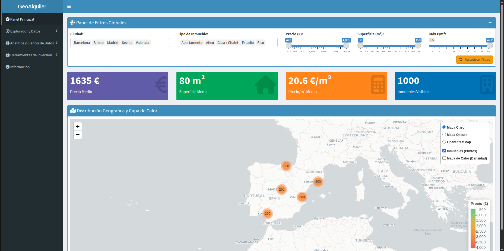

# GeoAlquiler · Guía técnica

**GeoAlquiler** es una aplicación web en R y Shiny que convierte datos de alquiler en información de mercado: un mapa interactivo de inmuebles, analítica y modelos de predicción, herramientas de inversión y un Observatorio del Alquiler con los municipios de España. Esta guía explica cómo está construida: cómo se organiza el código, cómo fluyen los datos, cómo se generan y cómo se ejecuta, prueba y despliega la app.

[Abrir la app](https://pdawgabriel-hub.shinyapps.io/geoalquiler/){ .md-button .md-button--primary }
[Código en GitHub](https://github.com/pdawgabriel-hub/geo-alquiler){ .md-button }
[README del proyecto](https://github.com/pdawgabriel-hub/geo-alquiler#readme){ .md-button }

## El proyecto en cifras

| | |
|---|---|
| Aplicación | Paquete de R con `{golem}` y 15 módulos de Shiny: mapa, analítica, predicción, recomendador, inversión y Observatorio |
| Anuncios | 4.085 inmuebles en Barcelona, Bilbao, Valencia, Madrid y Sevilla, con el €/m² de cada zona tomado de fuentes oficiales |
| Observatorio | Unos 8.100 municipios con datos de SERPAVI, INE (renta y padrón) y Catastro, referidos a 2022 |
| Datos | Pipeline offline en R que descarga, valida y cruza las fuentes, y genera dos ficheros Parquet |
| Calidad | 29 tests con 102 comprobaciones, incluidos módulos probados con `testServer()` |
| Automatización | GitHub Actions: tests en cada push, despliegue a shinyapps.io y publicación de esta guía |

## Cómo leer esta guía

Si quieres entender el diseño, empieza por [Arquitectura](arquitectura.md) y sigue con [Recorrido por el código](codigo.md). Si quieres ejecutar o modificar el proyecto, ve directamente a [Desarrollo local](desarrollo-local.md) y a [Dónde tocar para…](donde-tocar.md).

| Página | Qué explica |
|---|---|
| [Arquitectura](arquitectura.md) | Las tres capas de la app y qué datos recibe cada módulo |
| [Estructura del proyecto](estructura.md) | Qué hay en cada carpeta y las convenciones del paquete |
| [Recorrido por el código](codigo.md) | Los cinco patrones que se repiten en el código, con fragmentos reales |
| [Pipeline de datos](datos.md) | Cómo se descargan, validan y cruzan las fuentes, y el esquema de los datos |
| [Rendimiento](rendimiento.md) | Cómo carga rápido la app, en especial el mapa del Observatorio |
| [Desarrollo local](desarrollo-local.md) | Instalación y ejecución, en RStudio y en la terminal |
| [Calidad](calidad.md) | Tests e integración continua |
| [Despliegue](despliegue.md) | Cómo se publica en shinyapps.io y lo aprendido al hacerlo |
| [Dónde tocar para…](donde-tocar.md) | Qué ficheros cambiar para los cambios más habituales |

Para una visión general del proyecto, con todas las capturas de pantalla, consulta el [README](https://github.com/pdawgabriel-hub/geo-alquiler#readme).
